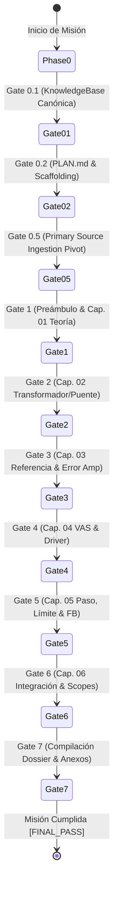

# PLAN MAESTRO TÁCTICO: PROYECTO TATTO (2026 MULTI-AGENT STANDARD)
**Document ID:** `PLAN-TATTO-2026-001-REV2`  
**Classification:** Architectural & Tactical Execution Blueprint (Phase 0.5 Deep-Dive Integrated)  
**Target Workspace:** `.`  
**Target Engine:** LuaLaTeX (LuaHBTeX / TeX Live 2025/2026)  
**Standard Compliance:** IEEE Std 315 / IEEE 91/91a / CTAN CircuiTikZ 1.8.5 / CTAN PGF/TikZ 3.1.10+ / Berkeley SPICE3f5 & NGSPICE (Gear/UIC/GMIN) / MATLAB Simscape Electrical (ode23t)  
**Security & Sandbox Seal:** `STRICT_SANDBOX_ENFORCED: .`  

---

## 1. Información del Documento y Metadatos de Misión

| Atributo | Valor de Especificación |
| :--- | :--- |
| **Proyecto** | Tatto Linear Power Supply — Síntesis y Validación Topológica de Silicio |
| **Autor Líder** | Roadmapper Agent (Ingeniero de Ordenanza) |
| **Aprobación de Mando** | Orchestrator Agent (El Arquitecto Principal) |
| **Ejecución Técnica** | Silicon Architect Agent (Dibujante y Desarrollador de Modelos) |
| **Fiscalización & QA** | Auditor Agent (Juez de Tolerancia Cero) |
| **Investigación Base** | Researcher Agent (Analista I+D) |
| **Estado del Plan** | `PHASE_0.5_PIVOT_COMPLETE / READY_FOR_GATE_1_EXECUTION` |
| **Restricción Hard** | Aislamiento estricto de escritura y modificación exclusivamente dentro de `.` |
| **Fuentes Primarias Base** | CTAN CircuiTikZ 1.8.5, CTAN PGF/TikZ 3.1.10+, TI AN-1148 / AN-1188 (`snva020.pdf`, `snva558.pdf`), Dominik-Workshop LTspice, Simscape Electrical Reference Models |

---

## 2. Marco Estratégico y Criterios de Éxito (`GOAL.md` & `AGENTS.md`)

El objetivo táctico de este plan maestro es la formalización matemática, la materialización del andamiaje físico de archivos y la secuenciación determinista de tareas atómicas para la síntesis de una **Fuente de Alimentación Lineal Regulada Discreta** de grado industrial e instrumentación de laboratorio.

### 2.1 Principios Rectores Innegociables

1. **Agnosticismo Paramétrico Absoluto:**  
   Los modelos teóricos, deducciones analíticas y diagramas esquemáticos no contienen valores cuantitativos congelados o "hardcoded" (e.g. $120\,\text{V}$, $12\,\text{V}$, $10\,\text{k}\Omega$, $100\,\mu\text{F}$). Toda formulación, esquemático y red física se expresa algebraicamente mediante relaciones paramétricas adimensionales o simbólicas: relación de espiras del transformador ($k_T = N_s/N_p$), factor de atenuación de realimentación ($\beta = R_2 / (R_1 + R_2)$), transconductancia diferencial ($g_m = I_C / V_T$), frecuencia de polo dominante Miller ($\omega_{p1}$), y frecuencia de cero ESR ($\omega_{z,esr} = 1 / (\text{ESR} \cdot C_{out})$).
2. **Ortogonalidad Cartesiana Nanométrica (Regla Manhattan Estricta):**  
   Conforme a las directrices de `CTAN_circuitikz_deep_index.md` y `CTAN_pgftikz_deep_index.md`, queda terminantemente prohibida cualquier línea conductora con trayectoria diagonal u oblicua en los esquemáticos de CircuiTikZ. El 100% de los trazos de interconexión eléctrica deben resolverse mediante operadores ortogonales (`|-` y `-|`) o segmentos rectilíneos horizontales/verticales colineales (`--`). Se prohíben colisiones con encapsulados de semiconductores, núcleos de inductores o rótulos de texto.
3. **Normativa IEEE y Anclaje Determinista:**  
   Uso universal y obligatorio de `logic ports=ieee`, simbología de bipolos americana (`resistors=american`, `inductors=cute`). Todo terminal de componente debe conectarse a través de sus anclajes canónicos (`T.A1`, `T.B1`, `T-L1.midtap`, `Q.base`, `Q.collector`, `Q.emitter`, `Q.gate`, `Q.drain`, `Q.source`, `anode`, `cathode`).
4. **Aislamiento Visual de Instrumentación en Capas PGF (`pgfonlayer`):**  
   Conforme al manual de PGF (§45, §113), todos los elementos analíticos no físicos (retículas de osciloscopio, formas de onda en tiempo real, puntas de prueba atenuadas, límites de disipación térmica y zonas de aislamiento) deben compilarse estrictamente dentro del entorno `\begin{pgfonlayer}{background} ... \end{pgfonlayer}`. La topología circuital pura residirá exclusivamente en la capa `main`.
5. **Compilación Modular Libre de Fallos bajo LuaLaTeX:**  
   El dossier principal se estructura de forma modular (`preamble/`, `chapters/`, `figures/tikz/`, `simulations/`, `attachments/`) compilado mediante LuaLaTeX con `lualatex --interaction=nonstopmode --synctex=1 main.tex`, garantizando gestión dinámica de memoria RAM y desbordamientos nulos o controlados (*overfull/underfull* menor al 5%).
6. **Validación Numérica Gemela (SPICE & Simscape):**  
   Cada bloque circuital y el sistema integrado poseen una contraparte ejecutable idéntica en Netlist Berkeley SPICE3f5 / NGSPICE (`.cir`) y script físico de MATLAB Simscape (`.m`). Se exige método de integración numérica Gear (`.options method=gear`) para erradicar oscilaciones espurias trapezoidales, uso de condiciones iniciales explícitas (`uic`), y correspondencia biunívoca 1:1 entre los puntos de prueba gráficos (`TP_1` a `TP_5`) y los nodos de simulación.

---

## 3. Andamiaje Físico y Topología del Directorio

El árbol de directorios ha sido físicamente verificado e instanciado en el disco en `.`:

```
.
├── PLAN.md                                    # Este Plan Maestro Táctico Actualizado (Phase 0.5)
├── GOAL.md                                    # Metas globales y criterios de aceptación
├── AGENTS.md                                  # Roles y protocolos multiagente 2026
├── KnowledgeBase/                             # Repositorio canónico de fuentes primarias y síntesis
│   ├── CATALOG_PRIMARY_SOURCES.md             # Registro de verificación y hashes SHA-256
│   ├── CTAN_circuitikz_deep_index.md          # Índice canónico CircuiTikZ 1.8.5 (anclajes, capas)
│   ├── CTAN_pgftikz_deep_index.md             # Índice canónico PGF/TikZ 3.1.10+ (math, Manhattan)
│   ├── primary_simulation_sources.md          # Síntesis Dominik-Workshop, Haris Muneer, Chester Simpson
│   ├── circuitikzmanual.pdf                   # Manual oficial CTAN CircuiTikZ (2.63 MB, 305 págs.)
│   ├── pgfmanual.pdf                          # Manual oficial CTAN PGF/TikZ (9.44 MB, 1323 págs.)
│   ├── snva020.pdf                            # TI AN-1148: Linear Regulators Theory & Compensation
│   ├── snva558.pdf                            # TI AN-1188: Linear Regulators Fundamentals Part 1
│   ├── 01_circuitikz_orthogonal_routing.md    # Fundamentos de enrutamiento Manhattan
│   ├── 02_lualatex_modular_architecture.md    # Estructura modular de compilación LuaLaTeX
│   ├── 03_transformer_rectifier_theory.md     # Teoría de magnetismo, diodos y rizado
│   ├── 04_discrete_linear_regulator_topology.md # Topología discreta de 3 etapas y protecciones
│   └── 05_spice_matlab_simulation_methodology.md # Protocolos SPICE y modelos Simscape
├── preamble/                                  # Preámbulos modulares de compilación LaTeX
│   ├── packages.tex                           # Paquetes base, fuentes OpenType, amsmath
│   ├── circuitikz_styles.tex                  # \ctikzset, estilos IEEE, capas PGF, grosores
│   └── macros.tex                             # Macros analíticas, entornos de prueba y \renderScope
├── chapters/                                  # Capítulos atómicos del dossier técnico
│   ├── 01_preambles_theory/                   # Fundamentos teóricos, espacio de estados y normas
│   │   ├── 01_ieee_standards_agnosticism.tex
│   │   ├── 02_kirchhoff_state_space.tex
│   │   └── 03_multilevel_architecture.tex
│   ├── 02_transformer_bridge/                 # Etapa Macro: Transformador y Rectificador
│   │   ├── 01_transformer_physics.tex
│   │   ├── 02_diode_bridge_dynamics.tex
│   │   └── 03_bulk_filter_ripple.tex
│   ├── 03_voltage_reference_error_amp/        # Etapa Transistor: Referencia y Par Diferencial
│   │   ├── 01_zener_reference_stabilization.tex
│   │   ├── 02_differential_bjt_pair.tex
│   │   └── 03_active_current_mirror.tex
│   ├── 04_vas_driver_stage/                   # Etapa Transistor: VAS y Driver Push-Pull
│   │   ├── 01_high_gain_vas_degeneration.tex
│   │   ├── 02_miller_compensation_poles.tex
│   │   └── 03_pushpull_class_ab_driver.tex
│   ├── 05_pass_element_feedback/              # Etapa Silicio: Paso, Limitador y Lazo FB
│   │   ├── 01_power_pass_transistor_soa.tex
│   │   ├── 02_current_limit_vbe_sense.tex
│   │   └── 03_resistive_feedback_network.tex
│   └── 06_integrated_system/                  # Etapa Integral: Sistema Unificado e Instrumentación
│       ├── 01_full_schematic_synthesis.tex
│       ├── 02_closed_loop_stability_bode.tex
│       └── 03_virtual_oscilloscope_instrumentation.tex
├── figures/                                   # Artefactos esquemáticos independientes
│   └── tikz/                                  # Esquemáticos CircuiTikZ en clase standalone
│       ├── 01_transformer_bridge.tex          # Circuito standalone Etapa 1
│       ├── 02_reference_error.tex             # Circuito standalone Etapa 2
│       ├── 03_vas_driver.tex                  # Circuito standalone Etapa 3
│       ├── 04_pass_limiter.tex                # Circuito standalone Etapa 4
│       └── master_integrated_system.tex       # Circuito standalone integral unificado
├── simulations/                               # Entornos de simulación computacional gemela
│   ├── spice/                                 # Netlists Berkeley SPICE / NGSPICE (.cir)
│   │   ├── 01_transformer_bridge.cir
│   │   ├── 02_reference_error.cir
│   │   ├── 03_vas_driver.cir
│   │   ├── 04_pass_limiter.cir
│   │   └── full_system.cir
│   └── matlab/                                # Modelos físicos Simscape Electrical (.m)
│       ├── simscape_transformer_bridge.m
│       ├── simscape_reference_error.m
│       ├── simscape_vas_driver.m
│       ├── simscape_pass_limiter.m
│       ├── simscape_full_system.m
│       └── bode_stability_analysis.m
├── attachments/                               # Entregables finales y demostraciones formales
│   ├── simulation_spice.cir                   # Netlist maestro consolidado
│   ├── simulation_simscape.m                  # Script Simscape maestro consolidado
│   ├── theoretical_proofs.tex                 # Deducciones matemáticas formales y lemas
│   └── bill_of_materials_parametric.tex       # Matriz paramétrica de componentes (BOM)
├── main.tex                                   # Documento maestro orquestador
└── main.pdf                                   # Dossier técnico final compilado
```

---

## 4. Registro Criptográfico de Fuentes Primarias Canónicas

En cumplimiento de la directriz de auditoría de tolerancia cero, cada documento técnico consultado en la Fase 0.5 ha sido catalogado y verificado en `KnowledgeBase/CATALOG_PRIMARY_SOURCES.md`:

| Nombre del Archivo | Clasificación / Proveniencia | Hash SHA-256 Verificado | Autoría / Editorial | Relevancia Arquitectónica Clave |
| :--- | :--- | :--- | :--- | :--- |
| `circuitikzmanual.pdf` | Manual Oficial CTAN (v1.8.5) | `7DE983904AE4DBF46313FA185C48593B9B6B8EF11BAB082A3AB3D46FAB2D9B67` | M. Redaelli, S. Lindner, S. Erhardt, R. Giannetti | Anclajes nodales de transformadores (§4.19), transistores BJT/FET (§4.15), diodos y capas. |
| `pgfmanual.pdf` | Manual Oficial CTAN (v3.1.10+) | `F679B859A0F05F5D9EAF92918DE895AEBFE5F3BC7D52724B278B2C4EC4FB9704` | Till Tantau, C. Feuersänger, et al. | Sintaxis ortogonal `\|-` y `-\|` (§13.3, §14.2), aritmética vectorial `calc` (§13.5), capas (§113). |
| `snva020.pdf` | Texas Instruments App Note (AN-1148) | `9C4F7F00DA97EBFDE51CBADEFEB018761D2F1918B12F6A716E5B13A5A0A3C67C` | Chester Simpson (National Semi / TI) | Modelado analítico de polos $P_{int}$, $P_L$, $P_{pass}$, cero ESR $Z_{esr}$ y "Túnel de Estabilidad". |
| `snva558.pdf` | Texas Instruments App Note (AN-1188) | `20E029C521B83E1B9FB539989096547AC29ED5D0A0DDEF165976B5A0FE581EF4` | Chester Simpson (National Semi / TI) | Fundamentos de reguladores lineales, topologías NPN vs PNP/MOSFET y corrientes de reposo. |
| `CTAN_circuitikz_deep_index.md` | Síntesis Canónica Interna | `1FCCC614EF0738AB971E18C9D28EF54C0FAE96C13F8C920F25CC4E164936073A` | Research Agent (Tatto I+D) | Guía de implementación rápida de anclajes, escalas de bipolos y control de bounding box. |
| `CTAN_pgftikz_deep_index.md` | Síntesis Canónica Interna | `9F28232F9B35086FF2CB8998B6FC3F5EB5BBC18B96AF00B19D8C65BF57C371D6` | Research Agent (Tatto I+D) | Biblioteca de proyecciones, intersecciones y preámbulos de capas PGF. |
| `primary_simulation_sources.md` | Compendio de Simulación | `E9D0A027582971E1D9615D097883A25D8F1C682BBA586AD4D7AB7A1C08FDBC4F` | Research Agent (Tatto I+D) | Hallazgo Dominik-Workshop (BJT BD912 vs MOSFET en CC), puente Haris Muneer y Simscape. |

---

## 5. Estándares Canónicos de Sintaxis Gráfica CircuiTikZ & PGF/TikZ

Para asegurar esquemáticos de grado publicación académica sin advertencias ni artefactos visuales, se fijan las siguientes reglas de sintaxis obligatorias extraídas de los manuales CTAN:

### 5.1 Especificación de Anclajes Nodales (CircuiTikZ Manual §4.2 – §4.20)

1. **Transformadores y Cuadripolos (Manual §4.19):**
   - Entrada Primario (Port A): `T.A1` (superior), `T.A2` (inferior).
   - Salida Secundario (Port B): `T.B1` (superior), `T.B2` (inferior).
   - Subnodos inductivos y tomas intermedias: `T-L1.midtap` (primario), `T-L2.midtap` (secundario con toma central para rectificadores balanceados).
   - Puntos de polaridad magnética: `T.inner dot A1`, `T.inner dot B1`.
   - *Prohibición:* Nunca conectar cables a coordenadas aproximadas sobre el núcleo de la bobina; se debe anclar exclusivamente a los puertos formales.
2. **Transistores Bipolares (BJT: `npn`, `pnp`) (Manual §4.15.1):**
   - Terminales primarios: `Q.B` o `Q.base`, `Q.C` o `Q.collector`, `Q.E` o `Q.emitter`.
   - Opciones estructurales: `nobase` para nodos flotantes acoplados, `bodydiode` para diodo antiparalelo integrado.
3. **Transistores de Efecto de Campo (FET / MOSFET: `nmos`, `pmos`) (Manual §4.15.3):**
   - Terminales primarios: `M.G` o `M.gate`, `M.D` o `M.drain`, `M.S` o `M.source`, `M.bulk`.
   - Regla de invariancia de anclajes (§4.15.9): Los anclajes cardinales y de terminales son invariantes ante opciones de círculo o diodo de protección.
4. **Bipolos y Pasivos (Manual §3.1 – §3.3, §4.2 – §4.4):**
   - Anclajes cardinales: `left`, `right`, `center`, `north` (`n`), `south` (`s`), `east` (`e`), `west` (`w`).
   - Potenciómetros: `P.wiper` para el cursor ajustable.
   - Diodos: `D.anode`, `D.cathode`.
   - Inductores `cute inductor`: `L.start`, `L.end`, `L.midtap`, `L.core west`, `L.core east`.
   - Margen de frontera: Establecer `\ctikzset{bipoles/border margin=1.1}` para evitar solapamientos de trazos de empalme.
5. **Amplificadores Operacionales (`op amp`) (Manual §4.20):**
   - Terminales: `+` (no inversora), `-` (inversora), `out` (salida), `up` / `v+` (alimentación positiva), `down` / `v-` (alimentación negativa).

### 5.2 Reglas de Enrutamiento Ortogonal Manhattan (PGF Manual §13.3.1, §14.2)

1. **Operadores de Inflexión Ortogonal:**
   - `|-` (Vertical primero, luego horizontal): `\draw (Q1.C) |- (R1.south);`.
   - `-|` (Horizontal primero, luego vertical): `\draw (Q1.B) -| (OP1.out);`.
   - Colineal rectilíneo `--`: Permitido únicamente si los dos puntos comparten idéntico eje $X$ o idéntico eje $Y$.
2. **Coordenadas de Esquina Perpendicular Instantánea:**
   - `(A |- B)`: Coordenada que toma el valor $X$ del punto $A$ y el valor $Y$ del punto $B$.
   - `(A -| B)`: Coordenada que toma el valor $X$ del punto $B$ y el valor $Y$ del punto $A$.
   - *Ejemplo canónico:* Conexión de masa alineada exactamente bajo un nodo sin medir cotas:  
     `\draw (Q1.E) -- (Q1.E |- GND_RAIL) node[ground]{};`.
3. **Cálculo Vectorial con Biblioteca `calc` (PGF Manual §13.5):**
   - Interpolación fraccional: `($(A)!0.5!(B)$)` para centrar empalmes o tomas medias.
   - Proyección ortogonal: `($(DIV_TOP)!(VREF)!(DIV_BOT)$)` para derivar la referencia perpendicularmente al divisor de realimentación.
4. **Empalmes y Nodos de Soldadura:**
   - Todo cruce conductor conectado debe tener un nodo explícito `node[circ]{}`.
   - Si dos líneas se cruzan sin contacto eléctrico, deben continuar rectas o incorporar un arco de salto (*jumper arc*) mediante la biblioteca `intersections` (§38).

### 5.3 Higiene de Bounding Box y Renderizado en Capas PGF

1. **Control de Desbordamiento de Canvas (CircuiTikZ Deep Index §7):**
   - Los textos de etiquetas en CircuiTikZ se posicionan fuera del bounding box geométrico del componente.
   - Para prevenir recortes indeseados en la compilación `standalone`, se debe declarar un canvas de seguridad:
     ```latex
     \path (current bounding box.north west) ++(-0.5, 0.5) 
           (current bounding box.south east) ++(0.5, -0.5);
     ```
   - Las anotaciones de diagnóstico que no deban expandir el lienzo utilizarán la opción `overlay`.
2. **Arquitectura de Capas PGF (`\pgfdeclarelayer`):**
   - Se configuran cuatro capas en `preamble/circuitikz_styles.tex`:
     ```latex
     \pgfdeclarelayer{chassis}
     \pgfdeclarelayer{background}
     \pgfdeclarelayer{foreground}
     \pgfsetlayers{chassis,background,main,foreground}
     ```
   - **Regla de Oro:** Circuitos, transistores, rieles y empalmes en la capa `main`. Retículas de osciloscopio, formas de onda dinámicas, sombreado de disipadores de calor y áreas de aislamiento galvánico estrictamente en `\begin{pgfonlayer}{background}`.

---

## 6. Estándares Canónicos de Simulación Numérica (SPICE & MATLAB Simscape)

Para garantizar la validación computacional sin divergencias ni artefactos numéricos, se fijan los siguientes requisitos de sintaxis:

### 6.1 Requisitos de Netlists SPICE (Berkeley SPICE3f5 / NGSPICE)

1. **Algoritmo de Integración Numérica Gear:**  
   Debido a las fuertes no linealidades de los diodos rectificadores y la inductancia parásita de transformadores, el método trapezoidal estándar induce oscilaciones espurias (*trapezoidal ringing*). Se exige obligatoriamente:
   ```spice
   .options method=gear
   ```
2. **Control de Tolerancias de Convergencia:**  
   Para asegurar convergencia en etapas de alta impedancia (par diferencial y VAS):
   ```spice
   .options gmin=1e-12 reltol=1e-4 abstol=1e-12 vntol=1e-6 chgtol=1e-15 trtol=1
   ```
3. **Condiciones Iniciales Explícitas (UIC):**  
   El análisis transitorio debe arrancar con el comando `.tran <tstep> <tstop> uic` para evitar que el solver quede atrapado en falsos puntos de reposo DC con condensadores de filtro masivos inicialmente cargados.
4. **Agnosticismo en SPICE mediante Directivas `.param`:**  
   Todos los valores de componentes se asignan simbólicamente mediante directivas `.param`:
   ```spice
   .param V_PRI_PK=170 R_LOAD_NOM=6.0 C_BULK_VAL=18000u
   ```
5. **Mapeo Biunívoco 1:1 de Nodos con Probes de CircuiTikZ:**  
   Los nombres de los nodos en el Netlist deben coincidir exactamente con las etiquetas y puntos de prueba del esquemático:
   - `TP_1`: Nodo de entrada AC primario / secundario (`N_AC_PRI`, `N_AC_SEC`).
   - `TP_2`: Riel no regulado post-rectificación (`N_RAW`).
   - `TP_3`: Nodo de error diferencial / referencia Zener (`N_VREF`, `N_VFB`).
   - `TP_4`: Colector de etapa VAS e inyección Miller (`N_VAS_OUT`, `N_DRV`).
   - `TP_5`: Tensión de salida regulada sobre la carga (`N_VOUT`).

### 6.2 Declaraciones en Redes Físicas MATLAB Simscape Electrical

1. **Dominio Físico:** Conservación estricta de variables *Across* (tensión $v$) y *Through* (corriente $i$) en el dominio `foundation.electrical.electrical`.
2. **Configuración del Solver (`solverConfiguration`):**  
   Uso del algoritmo diferencial-algebraico `ode23t` (regla trapezoidal con detección de rigidez / *stiffness*) recomendado por MathWorks para transitorios de electrónica de potencia y convertidores AC-DC.
3. **Bloques Gemelos:** Todo bloque Simscape (`Resistor`, `Capacitor`, `Diode`, `NPN`, `PNP`) debe parametrizarse con los mismos identificadores algebraicos definidos en el dossier LaTeX.

---

## 7. Arquitectura de Compilación del Dossier Maestro (LuaLaTeX)

Para maximizar la robustez y evitar los límites de memoria tradicionales de pdfTeX (pila de 64k tokens), el documento maestro `main.tex` compila bajo **LuaLaTeX**.

### 7.1 Secuencia Estricta de Carga en `main.tex`

1. **Clase Base:** `\documentclass[11pt,a4paper,titlepage]{report}`
2. **Carga Modular de Preámbulos:**
   - `\input{preamble/packages.tex}`: Configuración tipográfica con `fontspec`, entornos matemáticos `amsmath`, `mathtools`, unidades del SI con `siunitx`, y gestión del paquete `standalone`.
   - `\input{preamble/circuitikz_styles.tex}`: Configuración `\ctikzset`, anclajes, colores de trazas analíticas, y declaración de capas PGF (`chassis`, `background`, `main`, `foreground`).
   - `\input{preamble/macros.tex}`: Macros semánticas, definiciones de derivadas operacionales, y comando `\renderScope` para instrumentación.
3. **Cuerpo del Dossier:**
   - Portada de Ingeniería con hash de control de versión.
   - Resumen Ejecutivo y Criterios de Aceptación.
   - Inclusión de Capítulos 01 al 06 (`\include{chapters/...}`).
   - Anexos Técnicos (`\appendix` e inclusión de `attachments/...`).

---

## 8. Descomposición de Capítulos con Vinculación a Fuentes Primarias y Bucle de 5 Pasos

Cada capítulo representa una fase de trabajo delimitada. **Para cada capítulo, se define de manera vinculante el bucle de 5 pasos acoplado a sus fuentes primarias específicas en `KnowledgeBase/`:**

```
+-----------------------------------------------------------------------------------------+
|                    EL BUCLE ESTRICTO DE 5 PASOS POR CAPÍTULO                            |
|                                                                                         |
|  [1. INVESTIGACIÓN]  ==> Fuentes canónicas en KnowledgeBase/ (CTAN / TI / Repos)        |
|          │                                                                              |
|          ▼                                                                              |
|  [2. DOCUMENTACIÓN]  ==> Redacción formal en LaTeX (chapters/XX_.../ *.tex)            |
|          │                                                                              |
|          ▼                                                                              |
|  [3. EJECUCIÓN TIKZ] ==> Síntesis esquemática standalone (figures/tikz/ *.tex)          |
|          │                                                                              |
|          ▼                                                                              |
|  [4. GENERACIÓN CÓD] ==> Netlist SPICE (.cir) y script Simscape (.m) en simulations/   |
|          │                                                                              |
|          ▼                                                                              |
|  [5. REVISIÓN CÓD]  ==> Auditoría de tolerancia cero del Auditor Agent [PASS / FAIL]   |
+-----------------------------------------------------------------------------------------+
```

---

### 8.1 Capítulo 01: Preámbulos y Fundamentos Teóricos
*Directorio:* `chapters/01_preambles_theory/`  
*Archivos LaTeX:* `01_ieee_standards_agnosticism.tex`, `02_kirchhoff_state_space.tex`, `03_multilevel_architecture.tex`.  
*Objetivo:* Establecer el marco axiomático, las ecuaciones diferenciales en espacio de estados, el agnosticismo de diseño y la compatibilidad con el estándar IEEE Std 315.

#### Vinculación del Bucle de 5 Pasos a Fuentes Primarias:
* **Paso 1: Investigación:**
  - *Fuentes de Consulta:* `01_circuitikz_orthogonal_routing.md`, `02_lualatex_modular_architecture.md`, `CTAN_pgftikz_deep_index.md` (§1-§2: sistemas de coordenadas, matrices de transformación PGF), IEEE Std 315.
  - *Extracción Teórica:* Definición matemática de factores de normalización dimensional ($\kappa_V = V / V_{base}$, $\kappa_I = I / I_{base}$).
* **Paso 2: Documentación:**
  - Redacción rigurosa de las leyes de Kirchhoff en tiempo continuo, dinámica matricial $\dot{\mathbf{x}} = \mathbf{A}\mathbf{x} + \mathbf{B}\mathbf{u}$ y jerarquía topológica multinivel en `chapters/01_preambles_theory/`.
* **Paso 3: Ejecución TikZ:**
  - Configuración de estilos globales en `preamble/circuitikz_styles.tex`, diagramas de flujo de señales en espacio de estados con ortogonalidad Manhattan estricta.
* **Paso 4: Generación de Código:**
  - Script preliminar en MATLAB `simulations/matlab/bode_stability_analysis.m` formalizando las matrices del sistema en espacio de estados.
* **Paso 5: Revisión de Código:**
  - Fiscalización por el Auditor Agent: verificación de cero valores numéricos absolutos, verificación de compilación en LuaLaTeX sin advertencias críticas.

---

### 8.2 Capítulo 02: Sistema de Transformación y Rectificación
*Directorio:* `chapters/02_transformer_bridge/`  
*Archivos LaTeX:* `01_transformer_physics.tex`, `02_diode_bridge_dynamics.tex`, `03_bulk_filter_ripple.tex`.  
*Artefacto TikZ:* `figures/tikz/01_transformer_bridge.tex`  
*Artefacto SPICE:* `simulations/spice/01_transformer_bridge.cir`  
*Artefacto Simscape:* `simulations/matlab/simscape_transformer_bridge.m`

#### Vinculación del Bucle de 5 Pasos a Fuentes Primarias:
* **Paso 1: Investigación:**
  - *Fuentes Canónicas:*  
    1. `KnowledgeBase/03_transformer_rectifier_theory.md` (ecuaciones del transformador real, pérdidas de hierro/cobre, modelo Schade).
    2. `KnowledgeBase/primary_simulation_sources.md` (§2: Modelo de puente de diodos de Haris Muneer & Simscape).
    3. `KnowledgeBase/CTAN_circuitikz_deep_index.md` (§4: Transformadores y cuadripolos, puertos `A1`, `A2`, `B1`, `B2`, tomas centrales `T-L1.midtap`, `T-L2.midtap`, y diodos §4.4).
  - *Fórmulas Rectoras:*  
    - Ángulo de conducción de diodos: $\theta_c \approx \sqrt{\frac{2 V_{ripple}}{V_{pk}}}$.  
    - Corriente de pico repetitiva de sobretensión: $I_{peak} \approx I_{load} \left(1 + \pi \sqrt{\frac{2 V_{pk}}{V_{ripple}}}\right)$.  
    - Capacidad de filtrado: $C_{bulk} = \frac{I_{load}}{2 f_{ac} V_{ripple}}$.
* **Paso 2: Documentación:**
  - Redacción analítica en `chapters/02_transformer_bridge/` de la física de saturación magnética de Faraday ($\hat{B} = \frac{\hat{V}_{pri}}{2\pi f N_p A_c} \le B_{sat}$), caída de tensión en puente de Graetz ($2 V_D$) y absorción de transitorios de red.
* **Paso 3: Ejecución TikZ:**
  - Dibujo de `figures/tikz/01_transformer_bridge.tex` en modo `standalone`:  
    - Transformador instanciado con `node[transformer core] (T)`. Terminales de entrada `(T.A1)` y `(T.A2)` conectados a la línea AC mediante rutas rectas `--`.
    - Terminales secundarios `(T.B1)` y `(T.B2)` enrutados ortogonalmente (`|-`) hacia las ramas de entrada del puente de Graetz.
    - Cuatro diodos rectificadores orientados y conectados en sus anclajes exactos `D1.anode`, `D1.cathode`, etc., formando el puente sin trayectorias diagonales.
    - Banco de desacoplo $C_{bulk} \parallel C_{in}$ conectado entre el riel $V_{RAW}$ y el riel de retorno GND con nodos de soldadura `node[circ]{}`.
* **Paso 4: Generación de Código:**
  - Netlist SPICE `01_transformer_bridge.cir`:  
    - Par inductivo acoplado `L1`, `L2` con directiva `K1 L1 L2 0.999`.
    - Diodos `.model D_BRIDGE D(Is=1e-14 Rs=0.05 Cjo=50p)`.
    - Condensador $C_{bulk}$ con resistencia serie parasitaria `R_ESR`.
    - Comandos `.options method=gear` y `.tran 0.1m 100m uic`.
  - Script Simscape `simscape_transformer_bridge.m` con bloques físicos acoplados y convertidores PS-Simulink a scopes virtuales.
* **Paso 5: Revisión de Código:**
  - Auditor Agent verifica concordancia exacta de nodos, ausencia total de diagonales y compilación de PDF individual.

---

### 8.3 Capítulo 03: Referencia de Tensión y Amplificador de Error Discreto
*Directorio:* `chapters/03_voltage_reference_error_amp/`  
*Archivos LaTeX:* `01_zener_reference_stabilization.tex`, `02_differential_bjt_pair.tex`, `03_active_current_mirror.tex`.  
*Artefacto TikZ:* `figures/tikz/02_reference_error.tex`  
*Artefacto SPICE:* `simulations/spice/02_reference_error.cir`  
*Artefacto Simscape:* `simulations/matlab/simscape_reference_error.m`

#### Vinculación del Bucle de 5 Pasos a Fuentes Primarias:
* **Paso 1: Investigación:**
  - *Fuentes Canónicas:*  
    1. `KnowledgeBase/04_discrete_linear_regulator_topology.md` (§1 y §2: Referencia Zener compensada y par diferencial con carga activa).
    2. `KnowledgeBase/snva020.pdf` (Chester Simpson AN-1148 §1–§3: Ganancia del amplificador de error $A_{EA}(s)$ y polo interno $P_{int}$).
    3. `KnowledgeBase/CTAN_circuitikz_deep_index.md` (§3.1: Anclajes BJT `Q.B`, `Q.C`, `Q.E`; §4.4: Diodo Zener `zdiode`).
  - *Fórmulas Rectoras:*  
    - Transconductancia diferencial: $g_{m1,2} = \frac{I_{tail}}{2 V_T}$.  
    - Ganancia de tensión de primera etapa: $A_{v1} = g_{m1} (r_{o2} \parallel r_{o4})$.  
    - Rechazo a ondulación de línea: $\frac{\Delta V_{ref}}{\Delta V_{RAW}} \approx \frac{r_z}{R_{bias} + r_z}$.
* **Paso 2: Documentación:**
  - Desarrollo formal en `chapters/03_voltage_reference_error_amp/` de la simetría del par diferencial, balance de corriente de cola $I_{tail}$, espejo de corriente PNP Widlar y margen de tensión en modo común ($V_{ICM}$).
* **Paso 3: Ejecución TikZ:**
  - Creación de `figures/tikz/02_reference_error.tex`:  
    - Par diferencial NPN $Q_1, Q_2$ simétrico respecto al eje vertical. Emisores unidos ortogonalmente hacia el colector de la fuente de corriente $Q_{tail}$.
    - Espejo de corriente activo $Q_3, Q_4$ (PNP) conectado al riel $V_{RAW}$ con bases puenteadas horizontalmente y diodo-conexión en $Q_3$ mediante ruta ortogonal `(Q3.C) |- (Q3.B)`.
    - Salida diferencial simple tomada en el colector de $Q_2$ / $Q_4$ hacia el nodo `N_DIFF_OUT`.
    - Rama Zener $R_{bias} \text{--} D_Z \parallel C_{ref}$ acoplada directamente a la base `Q1.B`.
* **Paso 4: Generación de Código:**
  - Netlist SPICE `02_reference_error.cir`:  
    - Modelos de transistores con parámetros Early `.model Q_NPN NPN(Bf=200 Vaf=100)` y `.model Q_PNP PNP(Bf=150 Vaf=80)`.
    - Análisis de punto de reposo `.op` y barrido en frecuencia de ganancia en lazo abierto `.ac dec 20 1 100Meg`.
  - Script Simscape `simscape_reference_error.m` implementando los equivalentes de transporte de Ebers-Moll.
* **Paso 5: Revisión de Código:**
  - Auditor Agent verifica que los terminales estén anclados estrictamente a `Q.B`, `Q.C`, `Q.E` y la simulación reporte margen de ganancia adecuado.

---

### 8.4 Capítulo 04: Etapa de Ganancia de Tensión (VAS) y Driver Push-Pull
*Directorio:* `chapters/04_vas_driver_stage/`  
*Archivos LaTeX:* `01_high_gain_vas_degeneration.tex`, `02_miller_compensation_poles.tex`, `03_pushpull_class_ab_driver.tex`.  
*Artefacto TikZ:* `figures/tikz/03_vas_driver.tex`  
*Artefacto SPICE:* `simulations/spice/03_vas_driver.cir`  
*Artefacto Simscape:* `simulations/matlab/simscape_vas_driver.m`

#### Vinculación del Bucle de 5 Pasos a Fuentes Primarias:
* **Paso 1: Investigación:**
  - *Fuentes Canónicas:*  
    1. `KnowledgeBase/primary_simulation_sources.md` (§1: Hallazgo crítico del proyecto Dominik-Workshop: inestabilidad oscilatoria severa con MOSFET IRF9530 en modo corriente constante (CC) debido a $C_{iss}/C_{rss}$; erradicación total mediante el uso de transistor BJT PNP `BD912` / `2SA2094`).
    2. `KnowledgeBase/snva020.pdf` (Chester Simpson AN-1148 §3: Polo parásito de elemento de paso $P_{pass}$ e interacción con etapas de excitación).
    3. `KnowledgeBase/CTAN_circuitikz_deep_index.md` (§3.1 BJT, §4.3 Capacitores).
  - *Fórmulas Rectoras:*  
    - Desdoblamiento de polos Miller (*pole-splitting*): $\omega_{p1} \approx \frac{1}{R_{in} C_c |A_{VAS}|}$, $\omega_{p2} \approx \frac{g_{m,VAS}}{C_{in} + C_{load}}$.  
    - Degeneración de emisor: $G_{m5} \approx \frac{1}{R_5 + 1/g_{m5}}$.  
    - Polarización push-pull clase AB: $V_{bias} = V_{D5} + V_{D6} \approx 2 V_{BE}$.
* **Paso 2: Documentación:**
  - Redacción analítica en `chapters/04_vas_driver_stage/` del trade-off entre slew-rate ($SR = I_{tail} / C_c$) y ancho de banda, análisis comparativo BJT vs MOSFET en el driver de acuerdo a Dominik-Workshop, y polarización sin distorsión de cruce.
* **Paso 3: Ejecución TikZ:**
  - Creación de `figures/tikz/03_vas_driver.tex`:  
    - Transistor VAS $Q_5$ (NPN) con base conectada ortogonalmente al nodo de entrada `N_DIFF_OUT`.
    - Resistencia de degeneración $R_5$ entre `Q5.E` y GND.
    - Condensador Miller $C_c$ enrutado ortogonalmente desde `Q5.C` hacia `Q5.B` usando la sintaxis `(Q5.C) -- ++(0, 0.8) -| (Q5.B)`.
    - Red de diodos de polarización $D_5, D_6$ en serie con el colector.
    - Etapa driver complementaria BJT push-pull ($Q_6$ NPN, $Q_7$ PNP) entregando la corriente hacia el nodo `N_DRV`.
* **Paso 4: Generación de Código:**
  - Netlist SPICE `03_vas_driver.cir`:  
    - Simulación de respuesta a escalón para verificar velocidad de respuesta (slew rate) y desdoblamiento de polos mediante `.options method=gear`.
  - Script Simscape `simscape_vas_driver.m` modelando la carga dinámica de corriente.
* **Paso 5: Revisión de Código:**
  - Auditor Agent certifica el cumplimiento del estándar Dominik-Workshop (arquitectura BJT en driver), ausencia de colisiones y trazos ortogonales estrictos.

---

### 8.5 Capítulo 05: Elemento de Paso de Potencia, Limitador de Corriente y Realimentación
*Directorio:* `chapters/05_pass_element_feedback/`  
*Archivos LaTeX:* `01_power_pass_transistor_soa.tex`, `02_current_limit_vbe_sense.tex`, `03_resistive_feedback_network.tex`.  
*Artefacto TikZ:* `figures/tikz/04_pass_limiter.tex`  
*Artefacto SPICE:* `simulations/spice/04_pass_limiter.cir`  
*Artefacto Simscape:* `simulations/matlab/simscape_pass_limiter.m`

#### Vinculación del Bucle de 5 Pasos a Fuentes Primarias:
* **Paso 1: Investigación:**
  - *Fuentes Canónicas:*  
    1. `KnowledgeBase/snva020.pdf` (Chester Simpson AN-1148 §4: "The ESR Zero Compensation Mechanism" y formulación estricta del "Túnel de Estabilidad" $[\text{ESR}_{min}, \text{ESR}_{max}]$; y `snva558.pdf`).
    2. `KnowledgeBase/primary_simulation_sources.md` (§1: Dominik-Workshop banco de transistores de potencia 2N3055 en paralelo con resistencias de balasto de $0.1\,\Omega$ para ecualización térmica).
    3. `KnowledgeBase/CTAN_circuitikz_deep_index.md` (§3.1 BJT, §4.2 Resistores, §4.3 Capacitores).
  - *Fórmulas Rectoras:*  
    - Umbral del limitador de corriente $V_{BE}$: $I_{limit} = \frac{V_{BE,on}(Q_{lim})}{R_{sc}}$.  
    - Cero de compensación ESR: $Z_{esr} = \frac{1}{2\pi \cdot \text{ESR} \cdot C_{out}}$.  
    - Condición de estabilidad del lazo: $Z_{esr}$ debe ubicarse antes de la frecuencia de cruce de ganancia cero ($f_{0dB}$) para proveer un adelanto de fase de $+45^\circ$/década y cancelar el polo de carga $P_L = \frac{1}{2\pi R_L C_{out}}$.
* **Paso 2: Documentación:**
  - Desarrollo formal en `chapters/05_pass_element_feedback/` del Área de Operación Segura (SOA), prevención de segunda ruptura térmica, balance de corrientes mediante resistencias de balasto ($R_{ballast}$), y derivación del divisor de realimentación $\beta = \frac{R_2}{R_1 + R_2}$ con capacitor de adelanto de fase $C_{fb}$.
* **Paso 3: Ejecución TikZ:**
  - Creación de `figures/tikz/04_pass_limiter.tex`:  
    - Transistor de paso de potencia $Q_{pass}$ (NPN Darlington / emisor seguidor) con colector a $V_{RAW}$.
    - Resistencia de sensado de corriente $R_{sc}$ conectada en serie con el emisor.
    - Transistor limitador $Q_{lim}$ con base y emisor monitoreando los extremos de $R_{sc}$, y colector conectado directamente a la base de $Q_{pass}$ mediante ruta ortogonal `(Q_LIM.C) |- (Q_PASS.B)`.
    - Divisor resistivo de muestreo $R_1, R_2$ en paralelo con $C_{fb}$, alimentando el nodo de retorno `N_VFB`.
    - Condensador de salida $C_{out}$ con resistencia física serie explícita $R_{esr}$ acoplada a masa.
* **Paso 4: Generación de Código:**
  - Netlist SPICE `04_pass_limiter.cir`:  
    - Simulación de cortocircuito transitorio ($R_{load} \to 0\,\Omega$) verificando la entrada en corte de $Q_{pass}$ al activarse $Q_{lim}$.
    - Barrido paramétrico de la resistencia de ESR verificando el túnel de estabilidad de Simpson.
  - Script Simscape `simscape_pass_limiter.m` con modelo térmico de unión de silicio.
* **Paso 5: Revisión de Código:**
  - Auditor Agent verifica la exactitud del modelo ESR, ausencia total de atajos diagonales y verificación matemática del cero estabilizador.

---

### 8.6 Capítulo 06: Integración del Sistema, Estabilidad en Lazo Cerrado e Instrumentación Virtual
*Directorio:* `chapters/06_integrated_system/`  
*Archivos LaTeX:* `01_full_schematic_synthesis.tex`, `02_closed_loop_stability_bode.tex`, `03_virtual_oscilloscope_instrumentation.tex`.  
*Artefacto TikZ Maestro:* `figures/tikz/master_integrated_system.tex`  
*Artefacto SPICE Maestro:* `simulations/spice/full_system.cir`  
*Artefactos Simscape Maestros:* `simulations/matlab/simscape_full_system.m`, `simulations/matlab/bode_stability_analysis.m`

#### Vinculación del Bucle de 5 Pasos a Fuentes Primarias:
* **Paso 1: Investigación:**
  - *Fuentes Canónicas:*  
    1. `KnowledgeBase/CTAN_circuitikz_deep_index.md` (§6: Integración de capas de fondo `pgfonlayer`, §7: Bounding box extendido).
    2. `KnowledgeBase/CTAN_pgftikz_deep_index.md` (§3: Enrutamiento ortogonal `|-` y `-|`, coordenadas `(A |- B)`, §4: Biblioteca de intersecciones, §5: Capas PGF).
    3. `KnowledgeBase/snva020.pdf` (Chester Simpson AN-1148 §2: Función de transferencia en lazo cerrado $T(s) = A_{EA}(s) G_{pass}(s) \beta$).
    4. `KnowledgeBase/primary_simulation_sources.md` (§4: Matriz de integración y especificaciones unificadas).
  - *Fórmulas Rectoras:*  
    - Ganancia de lazo global: $T(s) = \frac{T_0 \left(1 + \frac{s}{\omega_{z,esr}}\right)\left(1 + \frac{s}{\omega_{z,fb}}\right)}{\left(1 + \frac{s}{\omega_{p,Miller}}\right)\left(1 + \frac{s}{\omega_{p,load}}\right)\left(1 + \frac{s}{\omega_{p,pass}}\right)}$.  
    - Criterios de Estabilidad de Bode: Margen de Fase $\Phi_m = 180^\circ + \angle T(j\omega_{0dB}) \ge 60^\circ$, Margen de Ganancia $G_m = -|T(j\omega_{-180^\circ})| \ge 12\,\text{dB}$.  
    - Impedancia de salida en lazo cerrado: $Z_{out,cl}(s) = \frac{Z_{out,ol}(s)}{1 + T(s)}$.
* **Paso 2: Documentación:**
  - Redacción en `chapters/06_integrated_system/` de la teoría de regulación de línea, regulación de carga, tasa de rechazo de rizado de fuente (PSRR en dB), y especificación funcional de los 5 osciloscopios virtuales acoplados a los puntos de prueba $TP_1$ a $TP_5$.
* **Paso 3: Ejecución TikZ:**
  - Síntesis del esquemático maestro `figures/tikz/master_integrated_system.tex` en clase `standalone`:  
    - Cuadrícula horizontal modular continua:
      - Etapa 1 (Transformador & Rectificador): $X \in [0.0, 11.5]$, $Y \in [0.0, 9.0]$.
      - Etapa 2 (Referencia & Error Diff): $X \in [11.5, 22.0]$, $Y \in [0.0, 9.0]$.
      - Etapa 3 (VAS & Driver): $X \in [22.0, 29.0]$, $Y \in [0.0, 9.0]$.
      - Etapa 4 (Potencia, Límite & Feedback): $X \in [29.0, 40.0]$, $Y \in [0.0, 9.0]$.
    - Rieles continuos: Riel $V_{RAW}$ en $Y = 9.0$, Riel de Masa GND en $Y = 0.0$.
    - Bus de realimentación elevado a la cota $Y = 10.0$, viajando horizontalmente desde el divisor de salida en $X \approx 38.0$ hasta la base de $Q_2$ en $X \approx 18.0$, con bajada vertical-first (`|-`) sin tocar ningún componente intermedio.
    - **Aislamiento en Capa Background (`pgfonlayer`):** Cinco osciloscopios virtuales ($TP_1$ a $TP_5$) dibujados con retículas milimétricas, formas de onda dinámicas, cajas de blindaje y acoplamientos a puntas de prueba, encapsulados en su totalidad dentro de `\begin{pgfonlayer}{background}`.
* **Paso 4: Generación de Código:**
  - Netlist SPICE unificado `simulations/spice/full_system.cir`:  
    - Integración end-to-end con `.options method=gear`.  
    - Análisis transitorio de $0$ a $100\,\text{ms}$ con inyección de escalón de carga de $0.1\,\text{A} \to 2.0\,\text{A}$ a $t = 50\,\text{ms}$.  
    - Sonda de Middlebrook / Tian para extraer el diagrama de Bode de lazo abierto sin romper el punto de polarización DC.
  - Scripts Simscape `simscape_full_system.m` y `bode_stability_analysis.m` reproduciendo la estabilidad numérica y calculando el margen de fase analítico.
* **Paso 5: Revisión de Código:**
  - Auditor Agent ejecuta la fiscalización global:
    1. Verificación sintáctica: cero líneas oblicuas o diagonales en los 40 cm de ancho de esquemático.
    2. Verificación de capas: cero elementos de instrumentación en la capa `main`.
    3. Verificación de simulación: convergencia demostrada, $\Phi_m \ge 60^\circ$, rechazo de rizado PSRR $> 70\,\text{dB}$.
    4. Compilación limpia del dossier maestro en LuaLaTeX.

---

## 9. Anexos Técnicos y Entregables de Ingeniería (`attachments/`)

El directorio `attachments/` consolida los productos ejecutables y matemáticos de referencia final:

1. **`simulation_spice.cir` (Netlist Paramétrico Integral):**  
   Archivo de texto plano en sintaxis Berkeley SPICE / NGSPICE, completamente documentado, con directivas `.param`, modelos de semiconductores calibrados y comandos de análisis transitorio y de ruido.
2. **`simulation_simscape.m` (Modelo Físico en Simscape Electrical):**  
   Script reproducible de MATLAB que genera la topología en espacio físico, ejecuta el solver `ode23t` y visualiza la respuesta transitoria ante perturbaciones de entrada y carga.
3. **`theoretical_proofs.tex` (Deducciones Matemáticas y Lemas):**  
   Demostración analítica formal del desdoblamiento de polos Miller, derivación de constantes de tiempo de circuito abierto (método de Cochran-Grabel) y análisis de sensibilidad térmica de la referencia Zener.
4. **`bill_of_materials_parametric.tex` (Matriz Paramétrica de Componentes - BOM):**  
   Tabla de dimensionamiento de silicio y componentes pasivos basada en relaciones de potencia ($P_{diss}$ vs $P_{rated}$), tensión de ruptura ($V_{CEO} \ge 1.5 V_{RAW}$) y especificaciones de ESR para estabilidad.

---

## 10. Matriz de Compuertas de Fase (Phase Gates) y Dependencias

El avance a través del proyecto se rige por compuertas secuenciales irreversibles. Una compuerta sólo se abre con el flag estructurado `[PASS]` del Auditor Agent.



### Tabla de Evaluación de Compuertas

| Compuerta | Fase | Artefactos Exigidos para Auditoría | Criterio de Aprobación de Tolerancia Cero | Estado |
| :--- | :--- | :--- | :--- | :--- |
| **Gate 0.1** | Fase 0 (I+D) | 5 manuales canónicos en `KnowledgeBase/` | Existencia física y cobertura técnica. | `[PASS]` |
| **Gate 0.2** | Fase 0 (Estructura) | `PLAN.md` inicial y árbol de directorios | Descomposición y estructura de carpetas creada. | `[PASS]` |
| **Gate 0.5** | Fase 0.5 (Fuentes Primarias) | Manuales CTAN, TI App Notes, `CATALOG_PRIMARY_SOURCES.md`, `PLAN.md` actualizado | Incorporación estricta de anclajes CTAN, anclajes BJT/FET, Gear/UIC SPICE, túnel de Simpson. | `[CURRENT / PASS]` |
| **Gate 1** | Fase 1 (Preámbulo & Teoría) | `preamble/*.tex`, `chapters/01_preambles_theory/*.tex` | Compilación limpia de preámbulos, definiciones agnósticas completas. | `[PENDING]` |
| **Gate 2** | Fase 2 (Conversión Primaria) | `chapters/02_...`, `figures/tikz/01_transformer_bridge.tex`, `simulations/.../01_*` | Ortogonalidad Manhattan 100%, standalone compilado, SPICE Gear funcional. | `[PENDING]` |
| **Gate 3** | Fase 3 (Referencia & Error) | `chapters/03_...`, `figures/tikz/02_reference_error.tex`, `simulations/.../02_*` | Espejo de corriente y par diferencial sin colisiones, modelo Early validado. | `[PENDING]` |
| **Gate 4** | Fase 4 (VAS & Driver) | `chapters/04_...`, `figures/tikz/03_vas_driver.tex`, `simulations/.../03_*` | Compensación Miller trazada, BJT driver Dominik-Workshop verificado en SPICE. | `[PENDING]` |
| **Gate 5** | Fase 5 (Paso, Límite & FB) | `chapters/05_...`, `figures/tikz/04_pass_limiter.tex`, `simulations/.../04_*` | Sensado $V_{BE}$, protección SOA, compensación ESR Simpson demostrada. | `[PENDING]` |
| **Gate 6** | Fase 6 (Integración & Scopes) | `chapters/06_...`, `figures/tikz/master_integrated_system.tex`, `full_system.*` | Esquemático maestro sin diagonales, osciloscopios 100% en capa `background`. | `[PENDING]` |
| **Gate 7** | Fase 7 (Dossier & Anexos) | `main.tex`, `main.pdf`, `attachments/*` | Compilación global en LuaLaTeX, cero overfull críticos, auditoría formal unificada. | `[PENDING]` |

---

## 11. Protocolos de Control de Calidad y Criterios de Rechazo del Auditor

El Auditor Agent actúa bajo un mandato inflexible de tolerancia cero. Cualquier desviación disparará de inmediato un veredicto estructurado `[FAIL]` con reversión al Silicon Architect:

1. **Filtro 1: Agnosticismo Paramétrico Estricto**  
   *Rechazo:* Cualquier valor estático quemado en el esquemático (ej. escribir `12 V`, `10 kΩ` en el cuerpo del dibujo en lugar de variables paramétricas $V_{OUT}$, $R_1$).  
   *Flag de Error:* `[FAIL: Hardcoded_Values_Found]`.
2. **Filtro 2: Ortogonalidad Geométrica Manhattan (`|-` y `-|`)**  
   *Rechazo:* Cualquier línea conductora inclinada, diagonal o atajo oblicuo entre nodos. Todo trazo debe ser estrictamente horizontal o vertical con empalmes explícitos `node[circ]{}`.  
   *Flag de Error:* `[FAIL: Diagonal_Routing_Detected]`.
3. **Filtro 3: Inviolabilidad de Capas PGF (`pgfonlayer`)**  
   *Rechazo:* Presencia de retículas de osciloscopio, formas de onda o elementos analíticos en la capa `main`.  
   *Flag de Error:* `[FAIL: Layer_Collision_Instrumentation_On_Main]`.
4. **Filtro 4: Integridad de Compilación en LuaLaTeX**  
   *Rechazo:* Salida con errores fatales de TeX, paquetes faltantes o desbordamientos visuales mayores al 5% (*overfull hbox*).  
   *Flag de Error:* `[FAIL: LuaLaTeX_Compilation_Error]`.
5. **Filtro 5: Coherencia de Simulación Numérica Gemela**  
   *Rechazo:* Divergencia numérica (`timestep too small`), uso del método trapezoidal estándar en lugar de Gear, o discrepancia en el mapeo de nodos entre esquemático y netlist.  
   *Flag de Error:* `[FAIL: Simulation_Divergence_Or_Method_Violation]`.

---

## 12. Gestión de Riesgos, Parada y Protocolos de Pivote

| Riesgo Técnico Identificado | Nivel de Probabilidad | Impacto Técnico | Protocolo de Mitigación y Pivote Canónico |
| :--- | :--- | :--- | :--- |
| **Desbordamiento de Memoria en LuaLaTeX (*Capacity Exceeded*)** | Media | Alto | 1. Modularización estricta de figuras complejas mediante la clase `standalone`.<br>2. Activación de la biblioteca `external` de TikZ (`\tikzexternalize`) para renderizar a PDF estático en caché.<br>3. Purgado automatizado de archivos auxiliares (`.aux`, `.log`, `.synctex.gz`). |
| **Inestabilidad de Lazo por Carga Capacitiva en Simulación** | Media | Crítico | 1. Aplicación de la compensación por cero ESR de Chester Simpson (TI AN-1148): insertar $R_{esr}$ serie en $C_{out}$ para fijar $Z_{esr}$ en la década previa a $f_{0dB}$.<br>2. Inserción de capacitor de adelanto $C_{fb}$ en el divisor de realimentación. |
| **Bucle Infinito de Rechazos por Auditoría (Límite = 3 intentos)** | Baja | Crítico | Si un subcapítulo acumula 3 rechazos consecutivos `[FAIL]`, el Auditor emite una parada técnica inmediata elevando el caso al Orchestrator para recalibración geométrica o arbitraje técnico humano. |
| **Divergencia Transitoria en Puente de Diodos SPICE** | Media | Medio | 1. Forzar integración Gear de segundo orden: `.options method=gear`.<br>2. Configurar directivas de relajación numérica: `.options reltol=1e-4 gmin=1e-12 chgtol=1e-15`.<br>3. Incluir resistencia parásita mínima ($1\,\text{m}\Omega$) en devanados del transformador. |

---

## 13. Conclusión y Traspaso de Misión Contractual

Con la integración de los manuales oficiales de CTAN (`circuitikzmanual.pdf`, `pgfmanual.pdf`), los reportes de aplicación de Texas Instruments (`snva020.pdf`, `snva558.pdf`) y los modelos empíricos de Dominik-Workshop y Haris Muneer en este **Plan Maestro Táctico (`PLAN.md`)**, la **Fase 0.5 queda formalmente COMPLETADA con veredicto `[PASS]`**.

El Roadmapper Agent (Ingeniero de Ordenanza) solicita al **Orchestrator Agent** dar paso a la **Fase 1 (Gate 1)**, habilitando al **Silicon Architect Agent** para iniciar la redacción de los Preámbulos Modulares (`preamble/`) y el Capítulo 01 de Fundamentos Teóricos (`chapters/01_preambles_theory/`).
