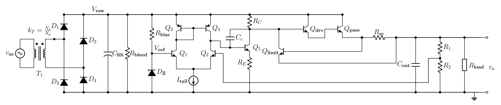
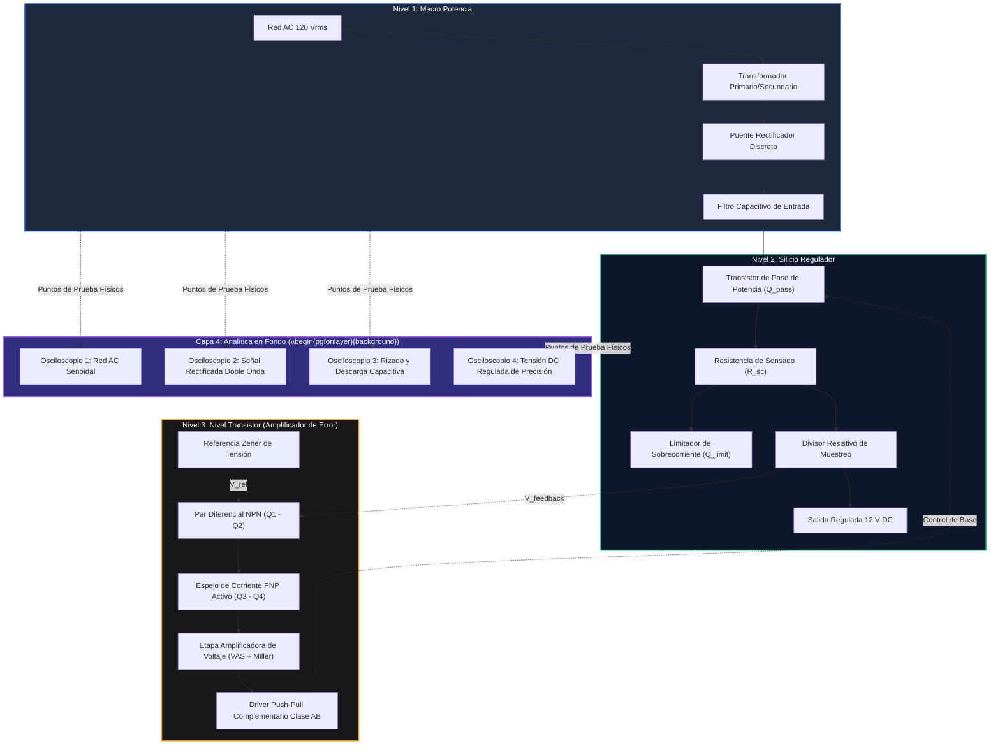

<div align="center">

# ⚡ PROYECTO TATTO
### Arquitectura Unificada de Fuente Lineal de Precisión en CircuiTikZ y Gemelos Digitales

[](LICENSE)
[](figures/tikz/master_integrated_v2_clean.tex)
[](preamble/circuitikz_styles.tex)
[](simulations/matlab/)
[](CITATION.cff)

<p align="center">
  <b>Un plano continuo de silicio y potencia que trasciende los diagramas de bloques convencionales:</b><br/>
  <i>Integración sinérgica de 4 capas con Zoom-In Topológico, osciloscopios analíticos de fondo y modelos multifísicos.</i>
</p>

---

</div>

## 🔬 Vista Previa Topológica de Alta Resolución

El esquema maestro compila a un solo plano continuo de proporciones ultra-panorámicas sin romper continuidad de nodos ni recurrir a abstracciones vacías:

<div align="center">

[](figures/tikz/master_integrated_v2_clean.pdf)

*Figura 1: Vista previa del esquemático unificado a nivel de silicio y componentes discretos ([figures/tikz/master_integrated_v2_clean.pdf](figures/tikz/master_integrated_v2_clean.pdf)). Renderizado vectorial generado con TikZ / CircuiTikZ bajo estándares IEEE Std 315.*

</div>

---

## 💡 Elevator Pitch Técnico: Más Allá de las "Cajas Negras"

La gran mayoría de la literatura técnica y diagramas de hardware recurren al facilismo metodológico de representar subsistemas complejos (como el regulador de tensión o el amplificador de error) como cajas negras rectangulares cerradas con terminales arbitrarios. Esto esconde la física del dispositivo, introduce discontinuidades de diseño y priva al ingeniero del análisis unificado de señal.

**Proyecto Tatto rompe este paradigma**:
* **Arquitectura Unificada en un Solo Plano:** La topología completa —desde la conmutación magnética de 120 V AC hasta la salida pura DC de 12 V— coexiste en un lienzo geométrico sin solución de continuidad.
* **Zoom-In Topológico Multinivel:** Los bloques reguladores no son íconos cerrados; se desglosan progresivamente revelando su silicio interno (par diferencial acoplado, espejo de corriente Wilson/estándar, etapa de ganancia VAS con compensación Miller y par push-pull complementario).
* **Análisis de Señal Integrado en Fondo (`\begin{pgfonlayer}{background}`):** Las trazas de osciloscopio analítico no están aisladas en apéndices distantes; se renderizan directamente en el mismo espacio geométrico detrás de los nodos de sensado físico mediante capas PGF, proyectando matemáticamente la transformación de la energía punto a punto.

---

## 🏛️ Jerarquía de 4 Capas (Zoom-In Topológico)

La arquitectura de Tatto se estructura en 4 niveles de abstracción complementaria rigurosamente enrutados:



---

## 📐 Estándares de Diseño y Rigor Normativo

El diseño esquemático se adhiere rígidamente a los principios de arte tipográfico científico y documentación de ingeniería:

| Regla de Ingeniería | Especificación Normativa | Implementación en CircuiTikZ |
| :--- | :--- | :--- |
| **Ortogonalidad Estricta** | Todas las interconexiones eléctricas transitan a 90° (`\|-` o `-\|`). Cero trazos diagonales no controlados. | Trazados deterministas en [preamble/circuitikz_styles.tex](preamble/circuitikz_styles.tex) |
| **Simbología IEEE** | Convención americana estándar (`american`, `logic ports=ieee`). | `\ctikzset{voltage/american, current/american}` |
| **Aislamiento de Símbolos** | Ningún bus de señal atraviesa el cuerpo interno de transistores BJT ni núcleos de transformador. | Rutas de desvío ortogonal perimetrales |
| **Identidad de Nodos** | Distinción explícita e inequívoca entre cruces pasivos sin contacto y empalmes eléctricos. | Nodos circulares rellenos `*-*` y separadores limpios |
| **Puntos de Prueba / Sondas** | Sondas desacopladas del nodo visual para evitar errores de renderizado de cabezas de flecha. | Trazo punteado ortogonal con terminación `\fill` circular independiente |
| **Superposición Espacial** | Los osciloscopios residen en las coordenadas nativas de los nodos a monitorear. | Declarados dentro de `\begin{pgfonlayer}{background}` |

---

## 🗂️ Árbol Estructural del Repositorio

El proyecto articula armónicamente código fuente tipográfico LaTeX, modelos SPICE y bancos de simulación multifísica en MATLAB/Simscape:

```text
Tatto/
├── figures/tikz/                                 # Código fuente vectorial CircuiTikZ
│   ├── master_integrated_v2_clean.tex           # Esquemático maestro integrado (versión de producción)
│   ├── master_integrated_v2_clean.pdf           # Vectorial compilado de alta resolución
│   ├── master_integrated_v3_math.tex            # Variante analítica avanzada
│   ├── master_integrated_system.tex             # Variante estándar
│   ├── master_integrated_system_vertical.tex    # Variante vertical orientada a dossier
│   └── 01_transformer_bridge.tex                # Subcircuito aislado del rectificador
├── preamble/                                     # Definiciones tipográficas y estilos
│   ├── circuitikz_styles.tex                    # Configuración IEEE Std 315 y paleta cromática
│   ├── macros.tex                               # Macros para componentes y subsistemas
│   └── packages.tex                             # Ingesta de paquetes CTAN
├── simulations/
│   ├── matlab/                                  # Gemelos digitales en MATLAB / Simscape
│   │   ├── simscape_integrated_system.m         # Simulación multifísica dinámica completa
│   │   ├── simscape_transformer_bridge.m        # Modelo dinámico de la etapa de conmutación y filtrado
│   │   ├── stress_testbench.m                   # Banco de pruebas de estrés térmico y sobrecarga
│   │   └── integrated_system_response.png       # Respuesta temporal en régimen permanente
│   └── spice/                                   # Netlists SPICE para validación analógica
│       ├── master_integrated_system.cir         # Netlist del sistema completo
│       ├── testbench_120v_to_12v.cir            # Testbench de caracterización de regulación
│       ├── 01_transformer_bridge.cir            # Netlist de rectificación
│       └── stress_testbench.cir                 # Testbench de carga transitoria
├── KnowledgeBase/                                # Monografías técnicas de diseño analógico
│   ├── 01_circuitikz_orthogonal_routing.md       # Fundamentos de ruteo ortogonal estricto
│   ├── 02_lualatex_modular_architecture.md      # Arquitectura de compilación LuaLaTeX
│   ├── 03_transformer_rectifier_theory.md       # Cálculos analíticos de factor de rizado
│   ├── 04_discrete_linear_regulator_topology.md # Topología de referencia y amplificador de error
│   ├── 05_spice_matlab_simulation_methodology.md# Metodología de gemelos digitales
│   └── 06_mathematical_transfer_functions_and_sensitivity.md # Funciones de transferencia
├── chapters/                                     # Capítulos del dossier técnico
│   ├── 06_integrated_system.tex                 # Ensamblaje documental del sistema
│   └── 06_integrated_system_body.tex            # Cuerpo teórico del capítulo 6
├── appendices/                                   # Anexos técnicos
│   └── A_digital_twins.tex                      # Documentación del gemelo digital
├── main.tex                                      # Documento maestro (LuaLaTeX)
├── CITATION.cff                                  # Metadatos de citación académica
├── LICENSE                                       # Licencia de hardware abierto CERN-OHL-S v2
└── CONTRIBUTING.md                               # Guía para contribuidores de hardware y LaTeX
```

---

## 🚀 Quick Start: Compilación y Simulación

### 1. Compilación del Esquemático Maestro (LaTeX / CircuiTikZ)

Para compilar el esquemático maestro o el dossier técnico completo, se requiere una distribución TeX moderna (TeX Live 2024+, MacTeX o MiKTeX) con LuaLaTeX:

```bash
# Opción A: Compilación automatizada con latexmk (Recomendado)
latexmk -lualatex -interaction=nonstopmode figures/tikz/master_integrated_v2_clean.tex

# Opción B: Compilación directa con LuaLaTeX
lualatex --interaction=nonstopmode figures/tikz/master_integrated_v2_clean.tex

# Opción C: Compilar el Dossier Monográfico Completo
lualatex --interaction=nonstopmode main.tex
```

> **Nota:** La librería `circuitikz` (>= 1.8.5) debe estar presente en el árbol `kpathsea` con soporte de capas TikZ `background`.

### 2. Ejecución de Gemelos Digitales (MATLAB / Simscape)

Para simular la respuesta transitoria y verificar la estabilidad de lazo cerrado:

```matlab
% Iniciar MATLAB y navegar al directorio de simulaciones
cd simulations/matlab

% Ejecutar el modelo multifísico del sistema integrado
run('simscape_integrated_system.m')

% Ejecutar el banco de pruebas de estrés transitorio
run('stress_testbench.m')
```

### 3. Validación Analógica con SPICE (Ngspice / LTspice)

```bash
cd simulations/spice

# Ejecutar la simulación del sistema integrado en ngspice
ngspice -b master_integrated_system.cir -r master_run.raw

# O ejecutar el testbench de regulación de carga
ngspice -b testbench_120v_to_12v.cir
```

---

## 🗺️ Roadmap & Help Wanted

Buscamos activamente la colaboración de **ingenieros de diseño analógico**, **especialistas en simulación física** y **artesanos de tipografía científica en LaTeX/TikZ**. 

Las siguientes áreas prioritarias se encuentran abiertas para contribuciones y pull requests:

- [ ] **Subcircuito de Protección Térmica Discreta:** Integración en silicio de sensado térmico acoplado al transistor de paso $Q_{pass}$ con histeresis por realimentación positiva.
- [ ] **Limitación de Corriente Foldback Activa:** Transición de la limitación de corriente constante actual a una curva *foldback* para mitigar la disipación térmica destructiva bajo cortocircuito permanente.
- [ ] **Pipeline Automatizado de Exportación SPICE Netlist:** Desarrollo de scripts de post-procesamiento que extraigan netlists ejecutables a partir de las coordenadas y etiquetas declaradas en `figures/tikz/*.tex`.
- [ ] **CI Vectorial en GitHub Actions:** Pipeline de renderizado automático de artefactos PDF y PNG en cada commit utilizando contenedores minimalistas de TeX Live.

¿Interesado en participar? Consulta [CONTRIBUTING.md](CONTRIBUTING.md) y [CODE_OF_CONDUCT.md](CODE_OF_CONDUCT.md) para conocer las pautas de estilo y gobernanza.

---

## 📜 Licencia y Citación

### Licencia de Hardware Abierto
Este proyecto se distribuye bajo la licencia **CERN Open Hardware Licence Strongly Reciprocal Version 2 ([CERN-OHL-S-2.0](LICENSE))**. Eres libre de estudiar, modificar y fabricar este diseño de hardware, siempre que cualquier redistribución o trabajo derivado mantenga la misma licencia y otorgue el debido crédito.

### Citación Académica
Si utilizas la arquitectura de Proyecto Tatto, sus esquemáticos en CircuiTikZ o sus gemelos digitales en investigaciones, publicaciones o diseños industriales, por favor cita el proyecto de acuerdo con [CITATION.cff](CITATION.cff):

```bibtex
@software{Alvarado_Proyecto_Tatto_2026,
  author = {Alvarado Hernández, Alonso},
  title = {{Proyecto Tatto: Arquitectura Unificada de Fuente Lineal (LaTeX / CircuiTikZ)}},
  year = {2026},
  url = {https://github.com/alonsoalvaradohr/Tatto},
  license = {CERN-OHL-S-2.0},
  version = {1.0.0}
}
```

<div align="center">
  <sub>Diseñado con precisión y rigor técnico por <b>Alonso Alvarado Hernández</b> y la comunidad abierta de Proyecto Tatto.</sub>
</div>
